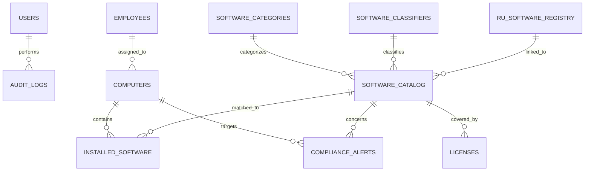

# Архитектура Базы Данных и API Спецификация для системы SAM (Software Asset Management)

Документ описывает структуру реляционной БД PostgreSQL (с расширением `pgvector`), модели данных, связи и полную спецификацию REST API эндпоинтов для бэкенда (FastAPI) и взаимодействия с фронтендом (Vue) и агентом сбора (Go).

---

## 1. Концептуальная архитектура и сущности

Система решает задачу сопоставления:
`Фактические инсталляции с ПК (Агент / Дамп)` $\to$ `Нормализация / Умный мэтчинг (pgvector + LLM)` $\to$ `Каталог разрешённого ПО компании` $\leftrightarrow$ `Лицензии (Баланс)` $\to$ `Комплаенс-контроль и риски`.



---

## 2. Структура Базы Данных (PostgreSQL + pgvector)

### 2.1. Таблица `users` (Администраторы системы)
Хранит учётные записи администраторов и операторов SAM.
```sql
CREATE TABLE users (
    id UUID PRIMARY KEY DEFAULT gen_random_uuid(),
    username VARCHAR(100) UNIQUE NOT NULL,
    password_hash VARCHAR(255) NOT NULL,
    full_name VARCHAR(255),
    role VARCHAR(50) DEFAULT 'admin', -- 'admin', 'operator', 'viewer'
    created_at TIMESTAMP WITH TIME ZONE DEFAULT NOW(),
    updated_at TIMESTAMP WITH TIME ZONE DEFAULT NOW()
);
```

### 2.2. Таблица `employees` (Сотрудники компании)
```sql
CREATE TABLE employees (
    id UUID PRIMARY KEY DEFAULT gen_random_uuid(),
    full_name VARCHAR(255) NOT NULL,
    email VARCHAR(255) UNIQUE,
    department VARCHAR(255),          -- Отдел / Подразделение
    position VARCHAR(255),            -- Должность
    status VARCHAR(50) DEFAULT 'active', -- 'active', 'dismissed', 'on_leave'
    created_at TIMESTAMP WITH TIME ZONE DEFAULT NOW(),
    updated_at TIMESTAMP WITH TIME ZONE DEFAULT NOW()
);
CREATE INDEX idx_employees_status ON employees(status);
```

### 2.3. Таблица `computers` (Рабочие станции / Хосты)
Ориентирована на сквозную идентификацию как живым Go-агентом, так и тестовыми дампами (`COMPUTERS.SERIAL_NUMBER`).
```sql
CREATE TABLE computers (
    id UUID PRIMARY KEY DEFAULT gen_random_uuid(),
    serial_number VARCHAR(255) UNIQUE NOT NULL, -- BIOS/WMI серийный номер
    hostname VARCHAR(255) NOT NULL,
    ip_address VARCHAR(45),
    mac_address VARCHAR(50),
    os_name VARCHAR(100),                       -- Windows 10, Windows 11, Linux
    os_version VARCHAR(100),
    cpu_info VARCHAR(255),
    ram_mb INTEGER,
    disk_info JSONB,
    is_online BOOLEAN DEFAULT FALSE,
    last_seen_at TIMESTAMP WITH TIME ZONE,
    employee_id UUID REFERENCES employees(id) ON DELETE SET NULL,
    created_at TIMESTAMP WITH TIME ZONE DEFAULT NOW(),
    updated_at TIMESTAMP WITH TIME ZONE DEFAULT NOW()
);
CREATE INDEX idx_computers_serial ON computers(serial_number);
CREATE INDEX idx_computers_employee ON computers(employee_id);
```

### 2.4. Таблица `software_categories` (Категории софта)
Категоризация по политике компании (Запрещённый, Устаревший, Актуальный).
```sql
CREATE TABLE software_categories (
    id SERIAL PRIMARY KEY,
    name VARCHAR(100) UNIQUE NOT NULL,  -- 'Запрещенный к использованию', 'Устаревший', 'Актуальный'
    description TEXT,
    is_problematic BOOLEAN DEFAULT FALSE, -- Флаг проблемы для дашборда
    risk_level VARCHAR(20) DEFAULT 'none',-- 'none', 'low', 'medium', 'critical'
    color_hex VARCHAR(7) DEFAULT '#6B7280'
);
```

### 2.5. Таблица `software_classifiers` (Классификатор классов ПО РФ)
Справочник классов ПО в соответствии с https://ru-ikt.ru/reestrpo и `data/Пример ПО.xlsx`.
```sql
CREATE TABLE software_classifiers (
    id SERIAL PRIMARY KEY,
    code VARCHAR(50) UNIQUE NOT NULL,    -- например: '04.03', '03.11'
    section_code VARCHAR(20) NOT NULL,   -- например: '04'
    section_name VARCHAR(255) NOT NULL,  -- '04 - Средства разработки программного обеспечения'
    class_name VARCHAR(255) NOT NULL     -- '04.03 - Библиотеки подпрограмм (SDK)'
);
```

### 2.6. Таблица `ru_software_registry` (Единый реестр отечественного ПО)
Синхронизируется раз в сутки с `reestr.digital.gov.ru` или импортируется из файла `data/Единый реестр Российского ПО.xlsx`.
```sql
CREATE TABLE ru_software_registry (
    id SERIAL PRIMARY KEY,
    reg_number VARCHAR(50) UNIQUE NOT NULL, -- Регистрационный номер
    name VARCHAR(500) NOT NULL,             -- Наименование ПО
    alternative_names TEXT,                 -- Синонимы и варианты названий через точку с запятой
    software_class TEXT,                    -- Класс ПО
    vendor_name VARCHAR(500),               -- Правообладатель
    vendor_inn VARCHAR(20),                 -- ИНН
    documentation_url TEXT,
    is_ai BOOLEAN DEFAULT FALSE,            -- Относится к ИИ
    excluded_at DATE,                       -- Дата исключения (если исключено)
    embedding vector(384),                  -- Вектор названия ПО для семантического поиска
    updated_at TIMESTAMP WITH TIME ZONE DEFAULT NOW()
);
CREATE INDEX idx_ru_registry_name ON ru_software_registry(name);
CREATE INDEX idx_ru_registry_embedding ON ru_software_registry USING ivfflat (embedding vector_cosine_ops);
```

### 2.7. Таблица `software_catalog` (Каталог разрешённого ПО компании — "Белый список")
Официальный корпоративный каталог софта. С ним сравниваются реальные инсталляции.
```sql
CREATE TABLE software_catalog (
    id UUID PRIMARY KEY DEFAULT gen_random_uuid(),
    name VARCHAR(255) NOT NULL,             -- Официальное наименование софта
    vendor VARCHAR(255),                    -- Производитель (Microsoft, Adobe, JetBrains)
    description TEXT,
    classifier_id INTEGER REFERENCES software_classifiers(id),
    ru_registry_id INTEGER REFERENCES ru_software_registry(id) ON DELETE SET NULL,
    category_id INTEGER REFERENCES software_categories(id),
    license_type VARCHAR(50) NOT NULL,      -- 'Commercial', 'Open Source', 'Freeware', 'Trial'
    max_installations INTEGER DEFAULT 0,    -- 0 = без ограничений (open source)
    embedding vector(384),                  -- Векторное представление для умного мэтчинга процессов
    created_at TIMESTAMP WITH TIME ZONE DEFAULT NOW(),
    updated_at TIMESTAMP WITH TIME ZONE DEFAULT NOW()
);
CREATE INDEX idx_software_catalog_embedding ON software_catalog USING ivfflat (embedding vector_cosine_ops);
```

### 2.8. Таблица `licenses` (Лицензии и соглашения)
```sql
CREATE TABLE licenses (
    id UUID PRIMARY KEY DEFAULT gen_random_uuid(),
    software_id UUID NOT NULL REFERENCES software_catalog(id) ON DELETE CASCADE,
    license_name VARCHAR(255) NOT NULL,
    license_type VARCHAR(50) NOT NULL,      -- 'Платный', 'Бесплатный', 'Условно бесплатный'
    license_model VARCHAR(50) DEFAULT 'per_device', -- 'per_device', 'per_user', 'site'
    total_purchased INTEGER NOT NULL DEFAULT 1,     -- Количество купленных лицензий
    unit_cost NUMERIC(12, 2) DEFAULT 0.00,          -- Стоимость 1 лицензии (руб.)
    currency VARCHAR(10) DEFAULT 'RUB',
    valid_from DATE,
    valid_to DATE,
    eula_text TEXT,                         -- Исходный текст EULA для ИИ-анализатора
    eula_analysis JSONB,                    -- Результат анализа ИИ (риски, коммерция)
    created_at TIMESTAMP WITH TIME ZONE DEFAULT NOW(),
    updated_at TIMESTAMP WITH TIME ZONE DEFAULT NOW()
);
CREATE INDEX idx_licenses_software ON licenses(software_id);
```

### 2.9. Таблица `installed_software` (Факты обнаружения/установки ПО на хостах)
Хранит данные с агентов/дампов и результат сопоставления с каталогом.
```sql
CREATE TABLE installed_software (
    id UUID PRIMARY KEY DEFAULT gen_random_uuid(),
    computer_id UUID NOT NULL REFERENCES computers(id) ON DELETE CASCADE,
    raw_display_name VARCHAR(500) NOT NULL, -- Имя из реестра/ОС: "studio_visual_2022.exe"
    raw_publisher VARCHAR(500),             -- "Microsoft Corporation"
    raw_version VARCHAR(255),               -- "17.4.2"
    install_path TEXT,                      -- "C:\Program Files\..."
    binary_hash VARCHAR(64),                -- SHA-256
    last_launched_at TIMESTAMP WITH TIME ZONE, -- Для выявления «зомби-софта»
    source VARCHAR(50) DEFAULT 'automatic',     -- 'agent', 'automatic', 'manual'
    
    -- Связь с эталонным каталогом после мэтчинга
    catalog_software_id UUID REFERENCES software_catalog(id) ON DELETE SET NULL,
    match_confidence REAL DEFAULT 0.0,      -- 0.0 - 1.0 (процент уверенности алгоритма/ИИ)
    is_verified_by_admin BOOLEAN DEFAULT FALSE,
    is_deleted BOOLEAN DEFAULT FALSE,       -- Если софт удалили с ПК
    first_seen_at TIMESTAMP WITH TIME ZONE DEFAULT NOW(),
    last_seen_at TIMESTAMP WITH TIME ZONE DEFAULT NOW()
);
CREATE INDEX idx_installed_comp ON installed_software(computer_id);
CREATE INDEX idx_installed_catalog ON installed_software(catalog_software_id);
CREATE INDEX idx_installed_last_launched ON installed_software(last_launched_at);
```

### 2.10. Таблица `compliance_alerts` (Журнал комплаенса и рисков)
Формируется автоматически движком комплаенса.
```sql
CREATE TABLE compliance_alerts (
    id UUID PRIMARY KEY DEFAULT gen_random_uuid(),
    alert_type VARCHAR(50) NOT NULL, 
    -- 'license_overuse' (дефицит лицензий / штрафной риск)
    -- 'zombie_software' (простаивающий софт / уволенный сотрудник)
    -- 'prohibited_software' (запрещённое ПО)
    -- 'shadow_it' (неопознанный / неавторизованный софт)
    -- 'commercial_risk' (личная бесплатная лицензия в компании)
    severity VARCHAR(20) NOT NULL,          -- 'info', 'warning', 'critical'
    computer_id UUID REFERENCES computers(id) ON DELETE CASCADE,
    software_id UUID REFERENCES software_catalog(id) ON DELETE CASCADE,
    title VARCHAR(255) NOT NULL,
    description TEXT NOT NULL,
    financial_risk_amount NUMERIC(12, 2) DEFAULT 0.00, -- Сумма потенциального штрафа/потери
    status VARCHAR(50) DEFAULT 'active',    -- 'active', 'acknowledged', 'resolved'
    created_at TIMESTAMP WITH TIME ZONE DEFAULT NOW(),
    resolved_at TIMESTAMP WITH TIME ZONE
);
CREATE INDEX idx_compliance_alerts_status ON compliance_alerts(status);
```

### 2.11. Таблица `import_history` (История импортов файлов)
```sql
CREATE TABLE import_history (
    id UUID PRIMARY KEY DEFAULT gen_random_uuid(),
    filename VARCHAR(255) NOT NULL,
    total_rows INTEGER DEFAULT 0,
    computers_affected INTEGER DEFAULT 0,
    software_rows_imported INTEGER DEFAULT 0,
    matched_automatically INTEGER DEFAULT 0,
    status VARCHAR(50) DEFAULT 'success',  -- 'processing', 'success', 'failed'
    error_message TEXT,
    created_at TIMESTAMP WITH TIME ZONE DEFAULT NOW()
);
```

---

## 3. Спецификация REST API (FastAPI)

Префикс всех эндпоинтов: `/api/v1`

### 3.1. Аутентификация и Первоначальная настройка (`/auth`, `/setup`)
* `GET /setup/status`
  * Ответ: `{ "is_initialized": bool }` (если false — фронтенд открывает экран создания первого админа).
* `POST /setup/init-admin`
  * Тело: `{ "username": "admin", "password": "...", "full_name": "Администратор" }`
  * Ответ: `{ "success": true, "token": "jwt..." }`
* `POST /auth/login`
  * Тело: `{ "username": "admin", "password": "..." }`
  * Ответ: `{ "access_token": "...", "token_type": "bearer" }`
* `GET /auth/me`
  * Ответ: `{ "id": "...", "username": "...", "role": "admin" }`

### 3.2. Главный дашборд (`/dashboard`)
* `GET /dashboard/summary`
  * Ответ:
    ```json
    {
      "total_computers": 150,
      "online_computers": 120,
      "offline_computers": 30,
      "total_employees": 140,
      "total_installed_software_count": 1820,
      "active_compliance_issues_count": 8,
      "total_financial_risk_rub": 450000.00
    }
    ```
* `GET /dashboard/compliance-overview`
  * Статистика по категориям рисков: перерасход лицензий, зомби-софт, запрещённое ПО.

### 3.3. Экран «Комплаенс-контроль» (`/compliance`)
* `GET /compliance/balance`
  * Сводная таблица «Куплено vs Установлено» по каждому ПО:
    ```json
    [
      {
        "software_id": "...",
        "software_name": "Microsoft Office 2021",
        "license_type": "Commercial",
        "purchased_count": 100,
        "installed_count": 120,
        "balance": -20,
        "unit_cost": 25000.00,
        "total_penalty_risk_rub": 500000.00,
        "status": "critical_overuse" // 'normal', 'critical_overuse', 'underutilized'
      }
    ]
    ```
* `GET /compliance/alerts`
  * Фильтры: `severity`, `alert_type`, `status`
  * Список подробных алертов с суммами рисков и привязкой к хостам.
* `GET /compliance/zombie-software`
  * Выборка софта, который не запускался > 60-90 дней или стоит у уволенных сотрудников.
* `POST /compliance/recalculate`
  * Принудительный перерасчёт всех правил комплаенса.

### 3.4. Сотрудники (`/employees`)
* `GET /employees` (Query: `search`, `department`, `status`, `page`, `limit`)
* `POST /employees` — создание сотрудника
* `GET /employees/{id}` — карточка сотрудника, список привязанных ПК и установленного на них софта
* `PUT /employees/{id}` — редактирование
* `DELETE /employees/{id}` — удаление

### 3.5. Компьютеры / Хосты (`/computers`)
* `GET /computers` (Query: `is_online`, `search`, `page`, `limit`)
* `POST /computers` — создание ПК вручную
* `GET /computers/{id}` — полная карточка ПК: характеристики железа, ОС, сотрудник, список установленного ПО
* `PUT /computers/{id}` — редактирование (в т.ч. смена сотрудника `employee_id`)
* `DELETE /computers/{id}` — удаление
* `POST /computers/{id}/software` — ручное добавление факта установки софта на ПК
* `DELETE /computers/{id}/software/{installed_software_id}` — ручное удаление факта установки

### 3.6. Каталог разрешённого ПО компании (`/catalog`)
* `GET /catalog` — эталонный белый список ПО компании
* `POST /catalog` — добавление ПО в каталог
* `GET /catalog/{id}` — карточка ПО (лицензия, лимиты, список ПК с установками)
* `PUT /catalog/{id}` — редактирование
* `DELETE /catalog/{id}` — удаление

### 3.7. Лицензии (`/licenses`)
* `GET /licenses` — список лицензий, их стоимости и остатков
* `POST /licenses` — регистрация закупки лицензий
* `GET /licenses/{id}` — детальная карточка
* `PUT /licenses/{id}` — редактирование
* `DELETE /licenses/{id}` — удаление

### 3.8. Категории софта (`/categories`)
* `GET /categories` — список категорий (Запрещённый, Устаревший, Актуальный)
* `POST /categories` — создать категорию
* `PUT /categories/{id}` — обновить
* `DELETE /categories/{id}` — удалить

### 3.9. Классификатор и Единый реестр отечественного ПО (`/classifiers`, `/registry`)
* `GET /classifiers` — иерархический список разделов и классов ПО
* `GET /registry` (Query: `search`, `class_code`, `page`, `limit`) — поиск по Единому реестру РФ
* `GET /registry/status` — дата последнего обновления, общее количество записей
* `POST /registry/sync` — ручной запуск обновления реестра с `reestr.digital.gov.ru`

### 3.10. Коннектор агента и Импорт дампов (`/connector`)
* `POST /connector/agent/report`
  * Эндпоинт для живого Go-агента.
  * Тело:
    ```json
    {
      "serial_number": "G69ZD5J",
      "hostname": "WORKSTATION-01",
      "ip_address": "192.168.1.45",
      "mac_address": "00:1A:2B:3C:4D:5E",
      "os_name": "Windows 11 Pro",
      "os_version": "22H2",
      "cpu": "Intel Core i7-12700K",
      "ram_mb": 32768,
      "installed_software": [
        {
          "display_name": "Google Chrome",
          "publisher": "Google LLC",
          "version": "67.208.108",
          "install_path": "C:\\Program Files\\Google\\Chrome",
          "binary_hash": "e3b0c44298fc1c149afbf4c8996fb92427ae41e4649b934ca495991b7852b855",
          "last_launched_at": "2026-11-14T12:30:00Z"
        }
      ]
    }
    ```
* `POST /connector/agent/heartbeat`
  * Пинг от агента для фиксации `is_online = true` и `last_seen_at = NOW()`.
* `POST /connector/import/upload`
  * Multipart/form-data загрузка файлов `.xlsx`, `.csv`, `.json` (например, тестового файла `data/Пример дампа с компов.xlsx`). Бэкенд автоматически создаёт ПК по `COMPUTERS.SERIAL_NUMBER`, сопоставляет софт и запускает комплаенс-анализ.
* `GET /connector/import/history` — список последних загрузок и количество распознанных строк.

### 3.11. ИИ-модули (`/ai`)
* `POST /ai/match-software`
  * Умный мэтчинг одного или нескольких грязных процессов.
  * Тело: `{ "raw_process_name": "studio_visual_2022.exe" }`
  * Ответ:
    ```json
    {
      "matched_catalog_software_id": "...",
      "matched_name": "Microsoft Visual Studio 2022",
      "confidence": 0.94,
      "reasoning": "Семантическое совпадение с каталогом разрешённого ПО компании"
    }
    ```
* `POST /ai/batch-normalize`
  * Фоновый запуск нормализации всех нераспознанных процессов в БД через `pgvector` и LLM.
* `POST /ai/analyze-eula`
  * Кейс Б из описания: анализ текста лицензионного соглашения.
  * Тело: `{ "eula_text": "...", "license_id": "..." }`
  * Ответ:
    ```json
    {
      "commercial_use_allowed": false,
      "risk_level": "high",
      "has_auto_renewal": true,
      "trial_period_days": 30,
      "key_restrictions": [
        "Запрещено использование юридическими лицами без приобретения коммерческой подписки",
        "Автоматическое списание средств по окончании пробного периода"
      ],
      "summary_ru": "Лицензия предназначена исключительно для личного некоммерческого использования."
    }
    ```
* `POST /ai/chat`
  * Кейс В из описания: AI-ассистент ИТ-директора (Text-to-SQL / RAG).
  * Тело: `{ "query": "У кого стоит нелицензионный софт и сколько денег мы рискуем потерять?" }`
  * Ответ:
    ```json
    {
      "answer": "Обнаружено 20 установок софта сверх купленных лицензий (дефицит в Microsoft Office). Общий финансовый штрафной риск составляет 500 000 рублей. Также у 3 уволенных сотрудников до сих пор числятся активные ПК с установленным ПО.",
      "sql_executed": "SELECT ...",
      "data": [ ... ]
    }
    ```
