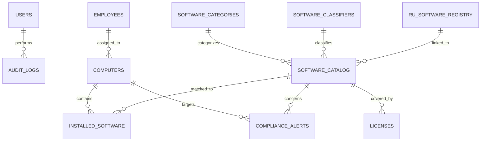
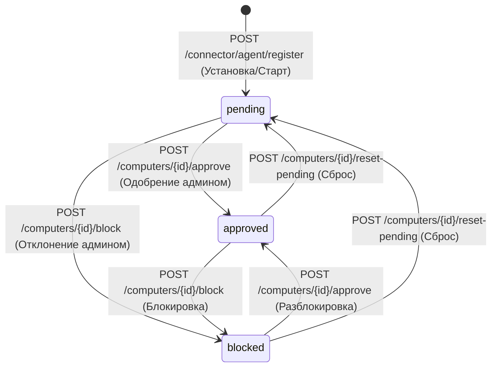

# Архитектура Базы Данных и API Спецификация для системы SAM (Software Asset Management)

Документ описывает структуру реляционной БД PostgreSQL (с расширением `pgvector`), модели данных, связи и полную спецификацию REST API эндпоинтов для бэкенда (FastAPI) и взаимодействия с фронтендом (Vue) и агентом сбора (Go).

---

## 1. Концептуальная архитектура и сущности

Система решает задачу сопоставления:
`Фактические инсталляции с ПК (Агент / Дамп)` $\to$ `Нормализация / Умный мэтчинг (pgvector + LLM)` $\to$ `Каталог разрешённого ПО компании` $\leftrightarrow$ `Лицензии (Баланс)` $\to$ `Комплаенс-контроль и риски`.



---

## 2. Структура Базы Данных (PostgreSQL + pgvector)

### 2.1. Таблица `users` (Администраторы системы)
Хранит учётные записи администраторов и операторов SAM.
```sql
CREATE TABLE users (
    id UUID PRIMARY KEY DEFAULT gen_random_uuid(),
    username VARCHAR(100) UNIQUE NOT NULL,
    password_hash VARCHAR(255) NOT NULL,
    full_name VARCHAR(255),
    role VARCHAR(50) DEFAULT 'admin', -- 'admin', 'operator', 'viewer'
    created_at TIMESTAMP WITH TIME ZONE DEFAULT NOW(),
    updated_at TIMESTAMP WITH TIME ZONE DEFAULT NOW()
);
```

### 2.2. Таблица `employees` (Сотрудники компании)
```sql
CREATE TABLE employees (
    id UUID PRIMARY KEY DEFAULT gen_random_uuid(),
    full_name VARCHAR(255) NOT NULL,
    email VARCHAR(255) UNIQUE,
    department VARCHAR(255),          -- Отдел / Подразделение
    position VARCHAR(255),            -- Должность
    status VARCHAR(50) DEFAULT 'active', -- 'active', 'dismissed', 'on_leave'
    created_at TIMESTAMP WITH TIME ZONE DEFAULT NOW(),
    updated_at TIMESTAMP WITH TIME ZONE DEFAULT NOW()
);
CREATE INDEX idx_employees_status ON employees(status);
```

### 2.3. Таблица `computers` (Рабочие станции / Хосты)
Ориентирована на сквозную идентификацию как живым Go-агентом, так и тестовыми дампами (`COMPUTERS.SERIAL_NUMBER`).
```sql
CREATE TABLE computers (
    id UUID PRIMARY KEY DEFAULT gen_random_uuid(),
    serial_number VARCHAR(255) UNIQUE NOT NULL, -- BIOS/WMI серийный номер
    hostname VARCHAR(255) NOT NULL,
    ip_address VARCHAR(45),
    mac_address VARCHAR(50),
    os_name VARCHAR(100),                       -- Windows 10, Windows 11, Linux
    os_version VARCHAR(100),
    cpu_info VARCHAR(255),
    ram_mb INTEGER,
    disk_info JSONB,
    is_online BOOLEAN DEFAULT FALSE,
    last_seen_at TIMESTAMP WITH TIME ZONE,
    enrollment_status VARCHAR(50) DEFAULT 'pending' NOT NULL, -- 'pending' (заявка), 'approved' (разрешён), 'blocked' (чёрный список)
    employee_id UUID REFERENCES employees(id) ON DELETE SET NULL,
    created_at TIMESTAMP WITH TIME ZONE DEFAULT NOW(),
    updated_at TIMESTAMP WITH TIME ZONE DEFAULT NOW()
);
CREATE INDEX idx_computers_serial ON computers(serial_number);
CREATE INDEX idx_computers_enrollment_status ON computers(enrollment_status);
CREATE INDEX idx_computers_employee ON computers(employee_id);
```

### 2.4. Таблица `software_categories` (Категории софта)
Категоризация по политике компании (Запрещённый, Устаревший, Актуальный).
```sql
CREATE TABLE software_categories (
    id SERIAL PRIMARY KEY,
    name VARCHAR(100) UNIQUE NOT NULL,  -- 'Запрещенный к использованию', 'Устаревший', 'Актуальный'
    description TEXT,
    is_problematic BOOLEAN DEFAULT FALSE, -- Флаг проблемы для дашборда
    risk_level VARCHAR(20) DEFAULT 'none',-- 'none', 'low', 'medium', 'critical'
    color_hex VARCHAR(7) DEFAULT '#6B7280'
);
```

### 2.5. Таблица `software_classifiers` (Классификатор классов ПО РФ)
Официальный справочник классов ПО в соответствии с Приказом Минцифры России № 486 от 22.09.2020, порталом https://ru-ikt.ru/reestrpo и Единым реестром отечественного ПО (`data/Единый реестр российского ПО.xlsx`). Включает полную иерархию 12 разделов и 159+ классов программного обеспечения.
```sql
CREATE TABLE software_classifiers (
    id SERIAL PRIMARY KEY,
    code VARCHAR(50) UNIQUE NOT NULL,    -- например: '04.03', '03.11', '01.01'
    section_code VARCHAR(20) NOT NULL,   -- например: '01'..'12'
    section_name VARCHAR(255) NOT NULL,  -- '04 - Средства разработки программного обеспечения'
    class_name TEXT NOT NULL             -- '04.03 - Библиотеки подпрограмм (SDK)'
);
```

### 2.6. Таблица `ru_software_registry` (Единый реестр отечественного ПО)
Синхронизируется раз в сутки с `reestr.digital.gov.ru` или импортируется из файла `data/Единый реестр Российского ПО.xlsx`.
```sql
CREATE TABLE ru_software_registry (
    id SERIAL PRIMARY KEY,
    reg_number VARCHAR(50) UNIQUE NOT NULL, -- Регистрационный номер
    name VARCHAR(500) NOT NULL,             -- Наименование ПО
    alternative_names TEXT,                 -- Синонимы и варианты названий через точку с запятой
    software_class TEXT,                    -- Класс ПО
    vendor_name VARCHAR(500),               -- Правообладатель
    vendor_inn VARCHAR(20),                 -- ИНН
    documentation_url TEXT,
    is_ai BOOLEAN DEFAULT FALSE,            -- Относится к ИИ
    excluded_at DATE,                       -- Дата исключения (если исключено)
    embedding vector(1536),                 -- Вектор названия ПО для семантического поиска (OpenAI text-embedding-3-small)
    updated_at TIMESTAMP WITH TIME ZONE DEFAULT NOW()
);
CREATE INDEX idx_ru_registry_name ON ru_software_registry(name);
CREATE INDEX idx_ru_registry_embedding ON ru_software_registry USING ivfflat (embedding vector_cosine_ops);
```

### 2.7. Таблица `software_catalog` (Каталог разрешённого ПО компании — "Белый список")
Официальный корпоративный каталог софта. С ним сравниваются реальные инсталляции.
```sql
CREATE TABLE software_catalog (
    id UUID PRIMARY KEY DEFAULT gen_random_uuid(),
    name VARCHAR(255) NOT NULL,             -- Официальное наименование софта
    vendor VARCHAR(255),                    -- Производитель (Microsoft, Adobe, JetBrains)
    description TEXT,
    classifier_id INTEGER REFERENCES software_classifiers(id),
    ru_registry_id INTEGER REFERENCES ru_software_registry(id) ON DELETE SET NULL,
    category_id INTEGER REFERENCES software_categories(id),
    license_type VARCHAR(50) NOT NULL,      -- 'Commercial', 'Open Source', 'Freeware', 'Trial'
    max_installations INTEGER DEFAULT 0,    -- 0 = без ограничений (open source)
    has_substitution BOOLEAN,               -- Флаг наличия рекомендованных отечественных аналогов в РФ
    substitutions_count INTEGER DEFAULT 0,  -- Количество найденных аналогов
    embedding vector(384),                  -- Векторное представление для умного мэтчинга процессов
    created_at TIMESTAMP WITH TIME ZONE DEFAULT NOW(),
    updated_at TIMESTAMP WITH TIME ZONE DEFAULT NOW()
);
CREATE INDEX idx_software_catalog_embedding ON software_catalog USING ivfflat (embedding vector_cosine_ops);
```

### 2.8. Таблица `licenses` (Лицензии и соглашения)
```sql
CREATE TABLE licenses (
    id UUID PRIMARY KEY DEFAULT gen_random_uuid(),
    software_id UUID NOT NULL REFERENCES software_catalog(id) ON DELETE CASCADE,
    license_name VARCHAR(255) NOT NULL,
    license_type VARCHAR(50) NOT NULL,      -- 'Платный', 'Бесплатный', 'Условно бесплатный'
    license_model VARCHAR(50) DEFAULT 'per_device', -- 'per_device', 'per_user', 'site'
    total_purchased INTEGER NOT NULL DEFAULT 1,     -- Количество купленных лицензий
    unit_cost NUMERIC(12, 2) DEFAULT 0.00,          -- Стоимость 1 лицензии (руб.)
    currency VARCHAR(10) DEFAULT 'RUB',
    valid_from DATE,
    valid_to DATE,
    eula_text TEXT,                         -- Исходный текст EULA для ИИ-анализатора
    eula_analysis JSONB,                    -- Результат анализа ИИ (риски, коммерция)
    created_at TIMESTAMP WITH TIME ZONE DEFAULT NOW(),
    updated_at TIMESTAMP WITH TIME ZONE DEFAULT NOW()
);
CREATE INDEX idx_licenses_software ON licenses(software_id);
```

### 2.9. Таблица `installed_software` (Факты обнаружения/установки ПО на хостах)
Хранит данные с агентов/дампов и результат сопоставления с каталогом.
```sql
CREATE TABLE installed_software (
    id UUID PRIMARY KEY DEFAULT gen_random_uuid(),
    computer_id UUID NOT NULL REFERENCES computers(id) ON DELETE CASCADE,
    raw_display_name VARCHAR(500) NOT NULL, -- Имя из реестра/ОС: "studio_visual_2022.exe"
    raw_publisher VARCHAR(500),             -- "Microsoft Corporation"
    raw_version VARCHAR(255),               -- "17.4.2"
    install_path TEXT,                      -- "C:\Program Files\..."
    binary_hash VARCHAR(64),                -- SHA-256
    last_launched_at TIMESTAMP WITH TIME ZONE, -- Для выявления «зомби-софта»
    source VARCHAR(50) DEFAULT 'automatic',     -- 'agent', 'automatic', 'manual'
    
    -- Связь с эталонным каталогом после мэтчинга
    catalog_software_id UUID REFERENCES software_catalog(id) ON DELETE SET NULL,
    match_confidence REAL DEFAULT 0.0,      -- 0.0 - 1.0 (процент уверенности алгоритма/ИИ)
    is_verified_by_admin BOOLEAN DEFAULT FALSE,
    is_deleted BOOLEAN DEFAULT FALSE,       -- Если софт удалили с ПК
    first_seen_at TIMESTAMP WITH TIME ZONE DEFAULT NOW(),
    last_seen_at TIMESTAMP WITH TIME ZONE DEFAULT NOW()
);
CREATE INDEX idx_installed_comp ON installed_software(computer_id);
CREATE INDEX idx_installed_catalog ON installed_software(catalog_software_id);
CREATE INDEX idx_installed_last_launched ON installed_software(last_launched_at);
```

### 2.10. Таблица `compliance_alerts` (Журнал комплаенса и рисков)
Формируется автоматически движком комплаенса.
```sql
CREATE TABLE compliance_alerts (
    id UUID PRIMARY KEY DEFAULT gen_random_uuid(),
    alert_type VARCHAR(50) NOT NULL, 
    -- 'license_overuse' (дефицит лицензий / штрафной риск)
    -- 'zombie_software' (простаивающий софт / уволенный сотрудник)
    -- 'prohibited_software' (запрещённое ПО)
    -- 'shadow_it' (неопознанный / неавторизованный софт)
    -- 'commercial_risk' (личная бесплатная лицензия в компании)
    severity VARCHAR(20) NOT NULL,          -- 'info', 'warning', 'critical'
    computer_id UUID REFERENCES computers(id) ON DELETE CASCADE,
    software_id UUID REFERENCES software_catalog(id) ON DELETE CASCADE,
    title VARCHAR(255) NOT NULL,
    description TEXT NOT NULL,
    financial_risk_amount NUMERIC(12, 2) DEFAULT 0.00, -- Сумма потенциального штрафа/потери
    status VARCHAR(50) DEFAULT 'active',    -- 'active', 'acknowledged', 'resolved'
    created_at TIMESTAMP WITH TIME ZONE DEFAULT NOW(),
    resolved_at TIMESTAMP WITH TIME ZONE
);
CREATE INDEX idx_compliance_alerts_status ON compliance_alerts(status);
```

### 2.11. Таблица `import_history` (История импортов файлов)
```sql
CREATE TABLE import_history (
    id UUID PRIMARY KEY DEFAULT gen_random_uuid(),
    filename VARCHAR(255) NOT NULL,
    total_rows INTEGER DEFAULT 0,
    computers_affected INTEGER DEFAULT 0,
    software_rows_imported INTEGER DEFAULT 0,
    matched_automatically INTEGER DEFAULT 0,
    status VARCHAR(50) DEFAULT 'success',  -- 'processing', 'success', 'failed'
    error_message TEXT,
    created_at TIMESTAMP WITH TIME ZONE DEFAULT NOW()
);
```

---

## 3. Спецификация REST API (FastAPI)

Префикс всех эндпоинтов: `/api/v1`

### 3.1. Аутентификация и Первоначальная настройка (`/auth`, `/setup`)
* `GET /setup/status`
  * Ответ: `{ "is_initialized": bool }` (если false — фронтенд открывает экран создания первого админа).
* `POST /setup/init-admin`
  * Тело: `{ "username": "admin", "password": "...", "full_name": "Администратор" }`
  * Ответ: `{ "success": true, "token": "jwt..." }`
* `POST /auth/login`
  * Тело: `{ "username": "admin", "password": "..." }`
  * Ответ: `{ "access_token": "...", "token_type": "bearer" }`
* `GET /auth/me`
  * Ответ: `{ "id": "...", "username": "...", "role": "admin" }`

### 3.2. Главный дашборд (`/dashboard`)
* `GET /dashboard/summary`
  * Ответ:
    ```json
    {
      "total_computers": 150,
      "online_computers": 120,
      "offline_computers": 30,
      "total_employees": 140,
      "total_installed_software_count": 1820,
      "active_compliance_issues_count": 8,
      "total_financial_risk_rub": 450000.00
    }
    ```
* `GET /dashboard/compliance-overview`
  * Статистика по категориям рисков: перерасход лицензий, зомби-софт, запрещённое ПО.

### 3.3. Экран «Комплаенс-контроль» (`/compliance`)
* `GET /compliance/balance`
  * Сводная таблица «Куплено vs Установлено» по каждому ПО:
    ```json
    [
      {
        "software_id": "...",
        "software_name": "Microsoft Office 2021",
        "license_type": "Commercial",
        "purchased_count": 100,
        "installed_count": 120,
        "balance": -20,
        "unit_cost": 25000.00,
        "total_penalty_risk_rub": 500000.00,
        "status": "critical_overuse" // 'normal', 'critical_overuse', 'underutilized'
      }
    ]
    ```
* `GET /compliance/alerts`
  * Фильтры: `severity`, `alert_type`, `status`
  * Список подробных алертов с суммами рисков и привязкой к хостам.
* `GET /compliance/zombie-software`
  * Выборка софта, который не запускался > 60-90 дней или стоит у уволенных сотрудников.
* `POST /compliance/recalculate`
  * Принудительный перерасчёт всех правил комплаенса.

### 3.4. Сотрудники (`/employees`)
* `GET /employees` (Query: `search`, `department`, `status`, `page`, `limit`)
* `POST /employees` — создание сотрудника
* `GET /employees/{id}` — карточка сотрудника, список привязанных ПК и установленного на них софта
* `PUT /employees/{id}` — редактирование
* `DELETE /employees/{id}` — удаление

### 3.5. Компьютеры / Хосты (`/computers`)
* `GET /computers` (Query: `is_online`, `search`, `status` [`pending`, `approved`, `blocked`], `page`, `limit`)
* `GET /computers/enrollment/stats` — сводная статистика по статусам: общее число, заявки (`pending`), разрешённые (`approved`), заблокированные (`blocked`)
* `POST /computers` — создание ПК вручную
* `GET /computers/{id}` — полная карточка ПК: характеристики железа, ОС, статус авторизации, сотрудник, список установленного ПО
* `PUT /computers/{id}` — редактирование (в т.ч. смена сотрудника `employee_id`)
* `PATCH /computers/{id}/status` — изменение статуса авторизации (`{"status": "approved" | "blocked" | "pending"}`)
* `POST /computers/{id}/approve` — быстрое одобрение ПК (разрешение приёма данных)
* `POST /computers/{id}/block` — добавление ПК в чёрный список (отклонение приёма данных с кодом 403)
* `POST /computers/{id}/reset-pending` — возврат ПК в список заявок на рассмотрение
* `DELETE /computers/{id}` — удаление
* `POST /computers/{id}/software` — ручное добавление факта установки софта на ПК
* `DELETE /computers/{id}/software/{installed_software_id}` — ручное удаление факта установки

### 3.6. Каталог разрешённого ПО компании (`/catalog`)
* `GET /catalog` — эталонный белый список ПО компании
* `POST /catalog` — добавление ПО в каталог
* `GET /catalog/{id}` — карточка ПО (лицензия, лимиты, список ПК с установками)
* `PUT /catalog/{id}` — редактирование
* `DELETE /catalog/{id}` — удаление

### 3.7. Лицензии (`/licenses`)
* `GET /licenses` — список лицензий, их стоимости и остатков
* `POST /licenses` — регистрация закупки лицензий
* `GET /licenses/{id}` — детальная карточка
* `PUT /licenses/{id}` — редактирование
* `DELETE /licenses/{id}` — удаление

### 3.8. Категории софта (`/categories`)
* `GET /categories` — список категорий (Запрещённый, Устаревший, Актуальный)
* `POST /categories` — создать категорию
* `PUT /categories/{id}` — обновить
* `DELETE /categories/{id}` — удалить

### 3.9. Классификатор и Единый реестр отечественного ПО (`/classifiers`, `/registry`)
* `GET /classifiers` (Query: `search`, `section_code`) — полный иерархический список разделов и классов ПО (12 разделов, 159+ классов)
* `POST /classifiers/sync` — ручной запуск синхронизации справочника классификаторов из `ru-ikt.ru/reestrpo` и `data/Единый реестр российского ПО.xlsx`.
  * Ответ:
    ```json
    {
      "success": true,
      "message": "Справочник классификаторов успешно синхронизирован: доступно 159 классов...",
      "total": 159,
      "added": 0,
      "updated": 0,
      "sources": [
        "https://ru-ikt.ru/reestrpo",
        "data/Единый реестр российского ПО.xlsx"
      ]
    }
    ```
* `GET /registry` (Query: `search`, `class_code`, `page`, `limit`) — поиск по Единому реестру РФ
* `GET /registry/status` — дата последнего обновления, общее количество записей
* `POST /registry/sync` — ручной запуск обновления реестра с `reestr.digital.gov.ru` / `data/Единый реестр российского ПО.xlsx`

### 3.10. Коннектор агента и Импорт дампов (`/connector`)
* `POST /connector/agent/register`
  * Первичная регистрация Go-агента при установке/первом запуске.
  * Если ПК новый, создаётся запись с `enrollment_status = "pending"` и `can_send_data = false`.
  * Тело:
    ```json
    {
      "serial_number": "G69ZD5J",
      "hostname": "WORKSTATION-01",
      "ip_address": "192.168.1.45",
      "mac_address": "00:1A:2B:3C:4D:5E",
      "os_name": "Windows 11 Pro",
      "os_version": "23H2",
      "cpu": "Intel Core i7-13700",
      "ram_mb": 32768
    }
    ```
  * Ответ (`AgentAuthResponse`):
    ```json
    {
      "serial_number": "G69ZD5J",
      "hostname": "WORKSTATION-01",
      "enrollment_status": "pending",
      "can_send_data": false,
      "message": "Заявка на добавление ПК принята и ожидает подтверждения администратором.",
      "server_time": "2026-11-15T05:00:00Z"
    }
    ```
* `POST /connector/agent/report`
  * Эндпоинт выгрузки инвентаризации софта для живого Go-агента.
  * **Контроль доступа**: Принимает отчёты строго от ПК со статусом `enrollment_status == "approved"`.
  * Если статус `pending` или `blocked`, сервер отклоняет запрос с `HTTP 403 Forbidden` и понятным описанием причины.
  * Тело:
    ```json
    {
      "serial_number": "G69ZD5J",
      "hostname": "WORKSTATION-01",
      "ip_address": "192.168.1.45",
      "mac_address": "00:1A:2B:3C:4D:5E",
      "os_name": "Windows 11 Pro",
      "os_version": "22H2",
      "cpu": "Intel Core i7-12700K",
      "ram_mb": 32768,
      "installed_software": [
        {
          "display_name": "Google Chrome",
          "publisher": "Google LLC",
          "version": "67.208.108",
          "install_path": "C:\\Program Files\\Google\\Chrome",
          "binary_hash": "e3b0c44298fc1c149afbf4c8996fb92427ae41e4649b934ca495991b7852b855",
          "last_launched_at": "2026-11-14T12:30:00Z"
        }
      ]
    }
    ```
* `POST /connector/agent/heartbeat`
  * Пинг от агента для фиксации `is_online = true` и `last_seen_at = NOW()`.
  * Возвращает текущий статус авторизации `enrollment_status` и флаг `can_send_data`.
  * Ответ:
    ```json
    {
      "status": "ok",
      "recognized": true,
      "enrollment_status": "approved",
      "can_send_data": true,
      "message": "ПК авторизован. Приём данных разрешён."
    }
    ```
* `POST /connector/import/upload`
  * Multipart/form-data загрузка файлов `.xlsx`, `.csv`, `.json` (например, тестового файла `data/Пример дампа с компов.xlsx`). Бэкенд автоматически создаёт ПК по `COMPUTERS.SERIAL_NUMBER` (со статусом `approved`), сопоставляет софт и запускает комплаенс-анализ.
* `GET /connector/import/history` — список последних загрузок и количество распознанных строк.

### 3.11. ИИ-модули (`/ai`)
* `POST /ai/match-software`
  * Умный мэтчинг одного или нескольких грязных процессов.
  * Тело: `{ "raw_process_name": "studio_visual_2022.exe" }`
  * Ответ:
    ```json
    {
      "matched_catalog_software_id": "...",
      "matched_name": "Microsoft Visual Studio 2022",
      "confidence": 0.94,
      "reasoning": "Семантическое совпадение с каталогом разрешённого ПО компании"
    }
    ```
* `POST /ai/batch-normalize`
  * Фоновый запуск нормализации всех нераспознанных процессов в БД через `pgvector` и LLM.
* `POST /ai/analyze-eula`
  * Кейс Б из описания: анализ текста лицензионного соглашения.
  * Тело: `{ "eula_text": "...", "license_id": "..." }`
  * Ответ:
    ```json
    {
      "commercial_use_allowed": false,
      "risk_level": "high",
      "has_auto_renewal": true,
      "trial_period_days": 30,
      "key_restrictions": [
        "Запрещено использование юридическими лицами без приобретения коммерческой подписки",
        "Автоматическое списание средств по окончании пробного периода"
      ],
      "summary_ru": "Лицензия предназначена исключительно для личного некоммерческого использования."
    }
    ```
* `POST /ai/chat`
  * Кейс В из описания: AI-ассистент ИТ-директора (Text-to-SQL / RAG).
  * Тело: `{ "query": "У кого стоит нелицензионный софт и сколько денег мы рискуем потерять?" }`
  * Ответ:
    ```json
    {
      "answer": "Обнаружено 20 установок софта сверх купленных лицензий (дефицит в Microsoft Office). Общий финансовый штрафной риск составляет 500 000 рублей. Также у 3 уволенных сотрудников до сих пор числятся активные ПК с установленным ПО.",
      "sql_executed": "SELECT ...",
      "data": [ ... ]
    }
    ```

---

## 4. Обновления и расширения архитектуры (Smart Matching Pipeline & Self-Learning DB)

### 4.1. Новая таблица `process_signatures` (Самообучающаяся база знаний сигнатур)
Исключает использование статических hardcoded словарей в коде. Любой распознанный процесс (по хэшу, Реестру РФ, Wikimedia, векторному сходству или через OpenAI LLM) сохраняется в этой таблице с эмбеддингом, что позволяет системе обучаться и ускоряться со временем.

```sql
CREATE TABLE process_signatures (
    id UUID PRIMARY KEY DEFAULT gen_random_uuid(),
    process_name VARCHAR(500) NOT NULL,            -- Имя процесса / исполняемого файла (например: "studio_visual_2022.exe")
    normalized_name VARCHAR(500) NOT NULL,         -- Каноническое наименование (например: "Microsoft Visual Studio 2022 Professional")
    binary_hash VARCHAR(64),                       -- Хэш SHA-256 (если известен)
    catalog_software_id UUID REFERENCES software_catalog(id) ON DELETE CASCADE,
    ru_registry_id INTEGER REFERENCES ru_software_registry(id) ON DELETE SET NULL,
    vendor VARCHAR(500),
    confidence REAL DEFAULT 1.0,
    match_source VARCHAR(50) NOT NULL,             -- 'hash', 'ru_registry', 'embedding', 'wikimedia', 'openai', 'admin', 'fuzzy_catalog'
    embedding vector(1536),                        -- Вектор OpenAI text-embedding-3-small (1536 измерений)
    times_matched INTEGER DEFAULT 1,               -- Счётчик популярности / частоты обращения
    created_at TIMESTAMP WITH TIME ZONE DEFAULT NOW(),
    updated_at TIMESTAMP WITH TIME ZONE DEFAULT NOW()
);

CREATE INDEX idx_proc_sig_name ON process_signatures(process_name);
CREATE INDEX idx_proc_sig_norm ON process_signatures(normalized_name);
CREATE INDEX idx_proc_sig_hash ON process_signatures(binary_hash);
CREATE INDEX idx_proc_sig_embedding ON process_signatures USING ivfflat (embedding vector_cosine_ops);
```

### 4.2. Обновление векторных представлений под OpenAI (`vector(1536)`)
Размерность векторных колонок `embedding` в таблицах `ru_software_registry`, `software_catalog` и `process_signatures` стандартизирована до **1536 измерений** (модель `text-embedding-3-small`).

### 4.3. Архитектура конвейера Smart Matching
Поиск и нормализация "грязных" процессов выполняются по строгому 8-ступенчатому конвейеру:
1. **Хэш файла в БД**: мгновенная сверка SHA-256 контрольной суммы с таблицами `process_signatures` и проверенными записями `installed_software` (`confidence: 1.0`, источник: `hash`).
2. **Эвристический поиск по БД (Путь установки + Имя .exe + Издатель)**: мгновенная локальная сверка структуры пути и имени файла с ранее верифицированными записями в `installed_software` и `software_catalog`. Решает проблему устаревания хэшей при минорных обновлениях билдов (например, `chrome.exe` или `1cv8.exe` обновились, но путь и исполняемый файл прежние). Сохраняет точную привязку к каталогу, **фиксирует новую реальную версию** (`matched_version = reported_version`), а новый хэш бинарника автоматически записывает в `process_signatures` для самообучения (`confidence: 0.90-0.96`, источник: `path_heuristic`).
3. **База обученных сигнатур в БД**: проверка наличия ранее распознанного процесса в таблице `process_signatures` (`match_source: process_signatures`).
4. **Единый реестр отечественного ПО**: поиск в таблице `ru_software_registry` (более 22 000 записей). При совпадении запись связывается с каталогом и сохраняется в базу знаний (`match_source: ru_registry`).
5. **Векторный семантический поиск по БД (OpenAI Embeddings)**: расчёт эмбеддинга запроса через `text-embedding-3-small` и косинусный поиск в базе по векторам `process_signatures` и `ru_software_registry` (`confidence: >= 0.82`, источник: `embedding`).
6. **Wikimedia Semantic Search API**: вызов Wikipedia API, извлечение статьи/аннотации, расчёт эмбеддинга и сохранение в БД (`confidence: 0.85-0.90`, источник: `wikimedia`).
7. **Нейросеть (OpenAI LLM)**: генерация канонического имени через `chat.completions` (JSON mode), автоматический расчёт эмбеддинга и сохранение в `process_signatures` (`confidence: 0.90-0.98`, источник: `openai`).
8. **Локальный фолбэк по каталогу**: нечёткое сопоставление по токенам с сохранением найденного совпадения в базу данных.

### 4.4. Дополнительные API эндпоинты

#### `POST /api/v1/matcher/match-software` (и `POST /api/v1/ai/match-software`)
* Расширенное тело запроса (включает путь установки и версию для эвристического сопоставления):
  ```json
  {
    "raw_process_name": "chrome.exe",
    "install_path": "C:\\Program Files\\Google\\Chrome\\Application\\chrome.exe",
    "version": "125.0.6422.60",
    "publisher": "Google LLC",
    "binary_hash": "e3b0c44298fc1c149afbf4c8996fb92427ae41e4649b934ca495991b7852b855"
  }
  ```
* Расширенный ответ с фиксацией актуальной версии и источника сопоставления:
  ```json
  {
    "raw_process_name": "chrome.exe",
    "matched_catalog_software_id": "00000000-0000-0000-0000-000000000002",
    "matched_name": "Google Chrome",
    "vendor": "Google LLC",
    "matched_version": "125.0.6422.60",
    "confidence": 0.96,
    "reasoning": "Эвристическое соответствие по пути установки ('C:\\Program Files\\Google\\Chrome\\Application\\chrome.exe') и исполняемому файлу 'chrome.exe' с эталонным ПО 'Google Chrome' (оценка сходства: 110%, актуальная версия: '125.0.6422.60').",
    "match_source": "path_heuristic" // 'hash', 'path_heuristic', 'ru_registry', 'embedding', 'wikimedia', 'openai', 'fuzzy_catalog'
  }
  ```

#### `POST /api/v1/registry/generate-embeddings`
* Запускает батч-генерацию векторных эмбеддингов для записей `ru_software_registry`, у которых поле `embedding` ещё не заполнено, через OpenAI Embeddings API (`text-embedding-3-small`).
* Query параметры: `limit` (по умолчанию 200).
* Ответ:
  ```json
  {
    "success": true,
    "generated_count": 200,
    "message": "Сгенерировано 200 векторных эмбеддингов для Единого реестра ПО РФ."
  }
  ```

### 4.5. Механизм самообучения и кэширования версий
1. **Автоматическая регистрация новых хэшей**: При обнаружении новой версии софта через эвристику по путям (Шаг 2) новый SHA-256 хэш файла сразу сохраняется в `process_signatures`. Это гарантирует, что при сканировании следующих ПК в сети тот же файл будет мгновенно опознан уже на **Шаге 1** (по хэшу) без дополнительных проверок.
2. **Исключение статических заглушек**: Все сопоставления хранятся в PostgreSQL (`process_signatures`, `installed_software`, `software_catalog`, `ru_software_registry`). С каждым обработанным дампом или отчётом агента скорость работы системы возрастает, а число обращений к внешним сервисам стремится к нулю.

---

### 4.6. Исправление ложных срабатываний коротких токенов (Защита от сопоставления `edge.exe` с `DEPOT-EDGE-M`)
* **Проблема**: Запросы с короткими именами процессов (например, `edge.exe` $\to$ `edge`, 4 символа) при нестрогом поиске по подстроке `%edge%` ошибочно захватывали сложные композитные названия из Единого реестра (например, `DEPOT-EDGE-M`).
* **Алгоритмическое решение (без хардкода)**:
  1. **SQL-фильтрация по границам слов**: Для коротких токенов ($\le 5$ символов) в таблице `ru_software_registry` выполняется поиск строго по границам слов (`name = name_low` либо с разделителями пробелами `name LIKE 'name_low %'` / `'% name_low'` / `'% name_low %'`).
  2. **Метрика схожести с ограничением по точности (Precision-bounded Dice score)**:
     $$\text{Precision} = \frac{|T_{query} \cap T_{target}|}{|T_{target} \setminus \text{Stopwords}|}$$
     Если целевое название содержит дополнительные отличительные брендовые токены, отсутствующие в запросе (как `DEPOT` и `M`), показатель точности падает ($1/3 = 0.33$), а итоговая схожесть принудительно ограничивается ($\le 0.26$).
  3. **Повышенный порог уверенности для Реестра ПО РФ**: Порог отсечения для коротких токенов установлен в `0.65`, что исключает ошибочную классификацию системного софта.

---

### 4.7. Модуль импортозамещения ПО (`reestr.digital.gov.ru`, HAR-парсер, Rate Limiting и Кэширование)

Модуль решает задачу автоматического выявления и подбора отечественных аналогов для используемого в компании зарубежного программного обеспечения на основе официального сервиса Минцифры России (`https://reestr.digital.gov.ru/import-substitution/`) и каталога АРПП «Отечественный софт».

#### 4.7.1. Таблица `import_substitutions` (Отечественные аналоги ПО)
Хранит соответствия между зарубежным ПО и рекомендованными отечественными аналогами (из сервиса Минцифры и каталога АРПП «Отечественный софт»).
```sql
CREATE TABLE import_substitutions (
    id UUID PRIMARY KEY DEFAULT gen_random_uuid(),
    foreign_software_name VARCHAR(255) NOT NULL,    -- Исходное зарубежное ПО (например, 'Photoshop')
    russian_software_name VARCHAR(500) NOT NULL,    -- Отечественный аналог (например, 'AliveColors', 'Artipic')
    russian_reg_number VARCHAR(50),                 -- № записи в Едином реестре (например, '4285', '22486')
    source VARCHAR(50) DEFAULT 'registry' NOT NULL, -- 'registry' (Реестр ПО) или 'arppsoft' (Каталог АРПП)
    owner_name VARCHAR(500),                        -- Правообладатель
    class_code VARCHAR(50),                         -- Код класса (например, '06.08')
    class_name VARCHAR(255),                        -- Наименование класса (например, 'Редакторы мультимедиа')
    registration_date VARCHAR(50),
    registry_url TEXT,
    ru_registry_id INTEGER REFERENCES ru_software_registry(id) ON DELETE SET NULL,
    catalog_software_id UUID REFERENCES software_catalog(id) ON DELETE SET NULL,
    created_at TIMESTAMP WITH TIME ZONE DEFAULT NOW()
);

CREATE INDEX idx_subs_foreign ON import_substitutions(foreign_software_name);
CREATE INDEX idx_subs_russian ON import_substitutions(russian_software_name);
CREATE INDEX idx_subs_reg_num ON import_substitutions(russian_reg_number);
```

#### 4.7.2. Таблица `substitution_cache` (Кэш проверок с TTL для защиты от DDoS)
Хранит результаты проверки статуса импортозамещения для каждого уникального распознанного продукта. Предотвращает повторные сетевые запросы для продуктов, у которых аналогов нет или они уже были найдены.
```sql
CREATE TABLE substitution_cache (
    id UUID PRIMARY KEY DEFAULT gen_random_uuid(),
    software_name VARCHAR(255) UNIQUE NOT NULL,     -- Нормализованное имя ПО в нижнем регистре
    has_substitution BOOLEAN DEFAULT FALSE NOT NULL,-- Флаг: найдены ли отечественные аналоги в РФ
    substitutions_count INTEGER DEFAULT 0 NOT NULL, -- Количество рекомендованных аналогов
    is_domestic BOOLEAN DEFAULT FALSE NOT NULL,     -- Флаг: входит ли само ПО в Единый реестр РФ
    status VARCHAR(50) DEFAULT 'checked' NOT NULL,  -- 'checked', 'domestic', 'not_found', 'error'
    catalog_software_id UUID REFERENCES software_catalog(id) ON DELETE SET NULL,
    last_checked_at TIMESTAMP WITH TIME ZONE DEFAULT NOW() NOT NULL,
    expires_at TIMESTAMP WITH TIME ZONE NOT NULL,   -- Срок действия кэша (TTL)
    error_message TEXT
);

CREATE INDEX idx_sub_cache_software_name ON substitution_cache(software_name);
CREATE INDEX idx_sub_cache_catalog_id ON substitution_cache(catalog_software_id);
CREATE INDEX idx_sub_cache_expires_at ON substitution_cache(expires_at);
```

#### 4.7.3. Политика кэширования и сроки жизни (TTL)
* **Зарубежное ПО с найденными аналогами / без аналогов**: кэшируется на **14 дней** (`CACHE_TTL_DAYS = 14`). Повторные обращения и загрузка страниц каталога берут данные из локальной БД мгновенно (0 мс) без сетевых запросов.
* **Отечественное ПО (из Единого реестра РФ)**: кэшируется на **30 дней** со статусом `domestic` (`is_domestic = True`, `has_substitution = False`). Поиск аналогов исключён, так как продукт уже отечественный.
* **Сетевые ошибки / таймаут сервиса**: кэшируется на **1 день** (`ttl_days = 1`) для исключения шторма повторных запросов при временной недоступности Минцифры.

#### 4.7.4. Механизм защиты от DDoS и Rate Limiting (`SubstitutionRateLimiter`)
Для исключения блокировок (HTTP 429 Too Many Requests, Cloudflare/WAF, капча) сервис оснащён компонентом контроля частоты запросов:
1. **Строгая последовательность запросов (Mutex Lock)**: `asyncio.Lock` гарантирует, что запросы к `reestr.digital.gov.ru` не выполняются параллельно.
2. **Интервал между сетевыми вызовами**: фиксированная задержка не менее **1.5 секунды** между любыми последовательными HTTP-запросами к внешнему серверу.
3. **Экспоненциальный откат (Backoff)**: при получении HTTP 429 или разрыве соединения задержка автоматически увеличивается на 5–10 секунд, защищая внешнюю инфраструктуру.
4. **Неблокирующий вызов в пуле потоков**: блокирующие вызовы библиотеки `requests` выполняются через `asyncio.get_running_loop().run_in_executor(None, ...)`, не блокируя событийный цикл FastAPI.

#### 4.7.5. Автоматический конвейер проверки нового ПО (Pipeline)
При добавлении нового ПО (через форму каталога `POST /api/v1/catalog`, импорт дампа агента `POST /api/v1/connector/agent/report` или `POST /api/v1/matcher/batch-normalize`):
1. **Фильтрация официальных названий (`is_official_software_name`)**: сырые имена процессов (`setup.exe`, `unins000.exe`, `svchost.exe`, бинарники без нормализации) отсекаются. Проверяются только распознанные официальные имена (например, `Adobe Photoshop`, `Docker Desktop`, `Zoom`).
2. **Проверка Единого реестра РФ (`check_is_in_ru_registry`)**: выполняется поиск в таблице `ru_software_registry` (по точному совпадению, синонимам и границам слов) и проверка `catalog_software.ru_registry_id`. Если софт отечественный — он помечается `is_domestic = True`, и запрос к сервису импортозамещения **не выполняется**.
3. **Проверка кэша в БД (`get_cached_substitution_status`)**: если запись в `substitution_cache` существует и `expires_at > NOW()`, результат возвращается из кэша без сетевого обращения.
4. **Асинхронная очередь задач (`_substitution_queue`) с дедупликацией**: новое зарубежное ПО ставится в фоновую очередь. Повторные добавления того же ПО во время обработки блокируются сетом `_enqueued_names`.
5. **Фоновый воркер (`substitution_queue_worker`)**: непрерывно обрабатывает очередь с задержкой 1.5 секунды, парсит карточки аналогов Минцифры, сохраняет их в `import_substitutions` и обновляет `substitution_cache` и поля `has_substitution`, `substitutions_count` в `software_catalog`.

#### 4.7.6. API Эндпоинты импортозамещения
* `GET /api/v1/substitution/search?query=Photoshop&force_fetch=false` — поиск аналогов для продукта (проверяет статус в реестре РФ, локальный кэш `substitution_cache`, при необходимости делает rate-limited сетевой запрос и сохраняет в БД).
* `GET /api/v1/substitution/suggestions?query=Photo` — автодополнение названий ПО через Bitrix AJAX эндпоинт `reestr.digital.gov.ru`.
* `GET /api/v1/substitution/catalog/{catalog_software_id}` — подбор российских аналогов для позиции корпоративного каталога ПО.
* `POST /api/v1/substitution/fetch-online?query=Photoshop` — прямой запуск rate-limited онлайн-проверки и сохранения аналогов с обновлением кэша в БД.
* `GET /api/v1/substitution/status/{software_name}` — моментальное получение статуса импортозамещения ПО (`domestic`, `checked`, `not_found`, `not_checked`) и срока действия кэша.
* `POST /api/v1/substitution/scan-catalog` — постановка всех непроверенных позиций зарубежного ПО из каталога в очередь фоновой проверки.
* `GET /api/v1/substitution/cache?limit=100` — список закэшированных проверок импортозамещения из таблицы `substitution_cache`.

#### 4.7.7. Отображение статуса импортозамещения в интерфейсе
* **Каталог ПО (`SoftwareCatalogView`)**: в таблице выведена отдельная колонка «Импортозамещение РФ»:
  * **В реестре РФ** (зелёный бэдж) — для отечественного софта;
  * **Есть аналог РФ (N)** (синий бэдж с кнопкой открытия модального окна) — для зарубежного софта с найденными аналогами;
  * **Нет в реестре РФ** (серый бэдж) — проверено, аналогов не зарегистрировано;
  * **Проверка...** — находится в очереди обработки.
* **Установленное ПО (`InstalledSoftwareView`)**: в столбце мэтчинга отображаются подписи `ПО РФ (Реестр)` или `Есть аналог РФ (N)` для моментального визуального контроля комплаенса.

---

### 4.8. Модуль учёта уязвимостей безопасности (БДУ ФСТЭК России / `vullist.xlsx`)

#### Таблица `vulnerabilities`
Интегрирована база данных угроз и уязвимостей безопасности информации ФСТЭК России (`https://bdu.fstec.ru/files/documents/vullist.xlsx`, 99 000+ записей).
```sql
CREATE TABLE vulnerabilities (
    id UUID PRIMARY KEY DEFAULT gen_random_uuid(),
    bdu_id VARCHAR(50) UNIQUE NOT NULL,             -- Идентификатор ФСТЭК (например, 'BDU:2024-00123')
    name TEXT NOT NULL,                             -- Наименование уязвимости
    description TEXT,                               -- Описание уязвимости
    vendor VARCHAR(255) NOT NULL,                   -- Вендор ПО
    software_name VARCHAR(255) NOT NULL,            -- Название ПО
    software_version TEXT,                          -- Уязвимые версии
    software_type VARCHAR(255),                     -- Тип ПО
    vuln_class VARCHAR(255),                        -- Класс уязвимости
    severity VARCHAR(50) DEFAULT 'Средний' NOT NULL,-- 'Критический', 'Высокий', 'Средний', 'Низкий'
    cvss_score REAL,                                -- Оценка CVSS (от 0.0 до 10.0)
    solution TEXT,                                  -- Меры по устранению
    status VARCHAR(100),
    exploit_status VARCHAR(255),                    -- Наличие эксплойта (например, 'Существует')
    cve_id VARCHAR(500),                            -- Идентификаторы CVE (например, 'CVE-2023-1234')
    publish_date VARCHAR(50),
    created_at TIMESTAMP WITH TIME ZONE DEFAULT NOW(),
    updated_at TIMESTAMP WITH TIME ZONE DEFAULT NOW()
);

CREATE INDEX idx_vuln_bdu_id ON vulnerabilities(bdu_id);
CREATE INDEX idx_vuln_vendor ON vulnerabilities(vendor);
CREATE INDEX idx_vuln_sw_name ON vulnerabilities(software_name);
CREATE INDEX idx_vuln_severity ON vulnerabilities(severity);
CREATE INDEX idx_vuln_cve_id ON vulnerabilities(cve_id);
```

#### API Эндпоинты уязвимостей
* `GET /api/v1/vulnerabilities` — список уязвимостей с поиском, фильтрами (`severity`, `vendor`, `has_exploit`) и пагинацией.
* `GET /api/v1/vulnerabilities/summary` — сводная статистика: общее число уязвимостей, число критических и высоких, число уязвимостей с подтверждёнными эксплойтами.
* `GET /api/v1/vulnerabilities/computer/{computer_id}` — соотнесение фактически установленного ПО на конкретном хосте с базой БДУ ФСТЭК и формирование отчёта об уязвимостях ПК.
* `GET /api/v1/vulnerabilities/software/{installed_software_id}` — уязвимости, выявленные для конкретной инсталляции программы.
* `POST /api/v1/vulnerabilities/sync` — потоковая загрузка и обновление базы уязвимостей из `data/уязвимости.xlsx` или онлайн с `https://bdu.fstec.ru/files/documents/vullist.xlsx`.

---

## 5. Авторизация клиентов и Жизненный цикл хостов (Enrollment Lifecycle)

### 5.1. Архитектура и граф состояний клиента (Go-агента)

При первичной установке и запуске агент не имеет автоматического доступа к выгрузке инвентаризационных данных на сервер SAM. Реализован строгий процесс верификации и допуска хостов администратором.



#### Статусы жизненного цикла (`enrollment_status`):
1. **`pending` (Заявка)**:
   * ПК зарегистрировался при первом запуске через `POST /api/v1/connector/agent/register`.
   * ПК отображается администратору во вкладке «Заявки» (`/computers?status=pending`).
   * Попытки выгрузки данных (`POST /api/v1/connector/agent/report`) отклоняются сервером с кодом **`403 Forbidden`**.
   * Фоновый агент отправляет `heartbeat`, получая `can_send_data = false`, и ожидает решения без спама сервера ошибками.
2. **`approved` (Разрешён)**:
   * Администратор одобрил подключение ПК через интерфейс (`POST /computers/{id}/approve` или `PATCH /computers/{id}/status`).
   * Сервер беспрепятственно принимает полные отчёты об установленном софте (`POST /api/v1/connector/agent/report`) и сопоставляет их с каталогом и лицензиями.
3. **`blocked` (Запрещён / Чёрный список)**:
   * Администратор отклонил заявку или заблокировал ПК (`POST /computers/{id}/block`).
   * Все попытки агента отправить отчёты немедленно отклоняются с кодом **`403 Forbidden`**.
   * ПК отображается во вкладке «Чёрный список» (`/computers?status=blocked`), откуда администратор может в любой момент восстановить его в `approved`.

---

### 5.2. Модель данных в PostgreSQL

В таблицу `computers` добавлено поле статуса авторизации с B-Tree индексом для мгновенной фильтрации сотен и тысяч рабочих станций:
```sql
ALTER TABLE computers 
ADD COLUMN enrollment_status VARCHAR(50) DEFAULT 'pending' NOT NULL;

CREATE INDEX idx_computers_enrollment_status ON computers(enrollment_status);
```
*(Миграция Alembic: `0003_add_computer_enrollment_status.py`)*

---

### 5.3. Спецификация REST API авторизации и управления хостами

#### 1. Регистрация нового агента: `POST /api/v1/connector/agent/register`
* **Назначение**: Первичный handshake агента при старте сервиса.
* **Request Body**:
```json
{
  "serial_number": "PC-SALES-4910",
  "hostname": "WORKSTATION-SALES-01",
  "ip_address": "192.168.1.144",
  "mac_address": "50:9A:4C:88:99:AA",
  "os_name": "Windows 11 Pro",
  "os_version": "23H2",
  "cpu": "Intel Core i5-13400",
  "ram_mb": 16384
}
```
* **Response (200 OK)**:
```json
{
  "serial_number": "PC-SALES-4910",
  "hostname": "WORKSTATION-SALES-01",
  "enrollment_status": "pending",
  "can_send_data": false,
  "message": "Заявка на добавление ПК принята и ожидает подтверждения администратором.",
  "server_time": "2026-11-15T05:00:00Z"
}
```

#### 2. Пинг и опрос статуса допуска: `POST /api/v1/connector/agent/heartbeat`
* **Request Body**:
```json
{
  "serial_number": "PC-SALES-4910",
  "hostname": "WORKSTATION-SALES-01"
}
```
* **Response (200 OK)**:
```json
{
  "status": "ok",
  "recognized": true,
  "enrollment_status": "pending",
  "can_send_data": false,
  "message": "Заявка ожидает подтверждения администратором."
}
```

#### 3. Выгрузка инвентаризации: `POST /api/v1/connector/agent/report`
* При `enrollment_status != "approved"` возвращает:
  * **Status**: `403 Forbidden`
  * **Response Body**:
    ```json
    {
      "detail": "Заявка на подключение данного ПК ожидает подтверждения администратором (статус: pending). Отправка данных отклонена."
    }
    ```
* При `enrollment_status == "approved"` данные принимаются и обрабатываются в обычном режиме (`200 OK`).

#### 4. Фильтрация ПК по статусу допуска: `GET /api/v1/computers`
Поддерживает query-параметры `status` и `enrollment_status`:
* `GET /api/v1/computers?status=pending` — возвращает **только заявки** на добавление новых ПК.
* `GET /api/v1/computers?status=approved` — возвращает **только разрешённые ПК**, от которых принимаются данные.
* `GET /api/v1/computers?status=blocked` — возвращает **только заблокированные ПК** (чёрный список).

#### 5. Сводные счетчики допуска: `GET /api/v1/computers/enrollment/stats`
* **Response (200 OK)**:
```json
{
  "total": 48,
  "pending": 3,
  "approved": 42,
  "blocked": 3
}
```

#### 6. Управление статусом авторизации администратором:
* **`PATCH /api/v1/computers/{id}/status`** — прямое переключение между любыми статусами:
  * Body: `{"status": "approved"}` (или `"blocked"`, `"pending"`)
* **`POST /api/v1/computers/{id}/approve`** — одобрить ПК и разрешить приём данных от агента.
* **`POST /api/v1/computers/{id}/block`** — заблокировать ПК и отправить в чёрный список.
* **`POST /api/v1/computers/{id}/reset-pending`** — вернуть ПК в состояние заявки.


